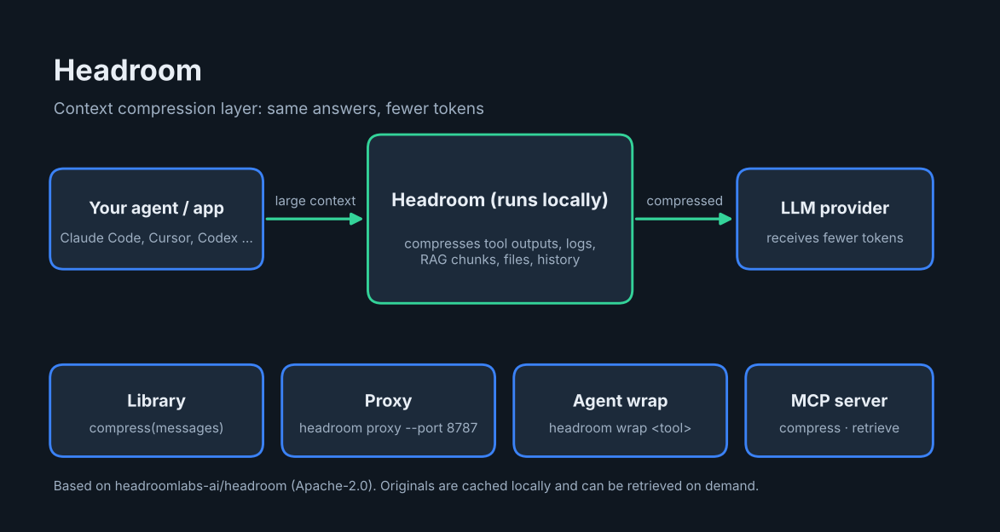

# Headroom: overview



**Headroom** compresses what your AI agent reads (tool outputs, logs, RAG chunks, files, conversation history) before it reaches the language model. The goal is the same answers with far fewer tokens. According to the upstream README, compression runs on your own machine, and no prompt or file content is sent anywhere to be compressed.

Upstream project: [headroomlabs-ai/headroom](https://github.com/headroomlabs-ai/headroom), license Apache-2.0.

## Ways to use it

| Mode | What it is |
| --- | --- |
| Library | `compress(messages)` in Python or TypeScript, inside your own app. |
| Proxy | `headroom proxy --port 8787`: no code changes, works with any language. |
| Agent wrap | `headroom wrap claude` (and other agents such as codex, cursor, aider, opencode, cline); undo with `headroom unwrap <tool>`. |
| MCP server | `headroom_compress`, `headroom_retrieve`, `headroom_stats` for any MCP client. |

Other features listed upstream: cross-agent memory, `headroom learn` (mines failed sessions and writes corrections into files such as `CLAUDE.local.md`), output-token reduction, and reversible compression: originals are cached locally and can be retrieved on demand.

The upstream demo shows a 10,144-token log dump compressed to 1,260 tokens while a key `FATAL` line is preserved. Those figures come from the project's own README, not from a test run here.

## Install

The project is published as `headroom-ai` on PyPI and npm. For the current install steps and per-agent setup, follow the upstream [Quickstart](https://docs.headroomlabs.ai/docs/quickstart).

## Things to know

- Compression is lossy by design but reversible through the local cache; verify results on your own workloads before relying on it for critical tasks.
- Wrapping an agent changes how it connects to the model. Use `headroom unwrap <tool>` to revert.

---

Overview prepared by Ashraf Saed | MIGATRONIX. The project itself belongs to its original authors; see its license.

## Automatic install

```bash
git clone https://github.com/AshrafSaed/headroom-guide.git
cd headroom-guide
bash install.sh
```

Or open this folder in Claude Code and say "install headroom": the skill `install-headroom` (in `.claude/skills/`) runs the same script.

- Follows upstream README (`uv tool install`). Wrapping an agent (`headroom wrap claude`) changes how it connects to the model, so the installer does NOT do it automatically; undo with `headroom unwrap <tool>`.
- After install: Run `headroom --help`. Optional next step: `headroom wrap claude`.
